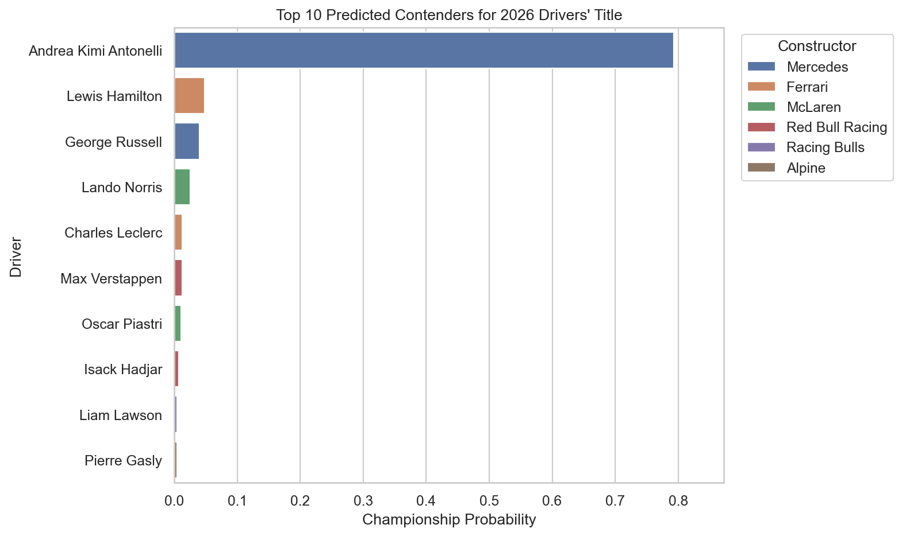
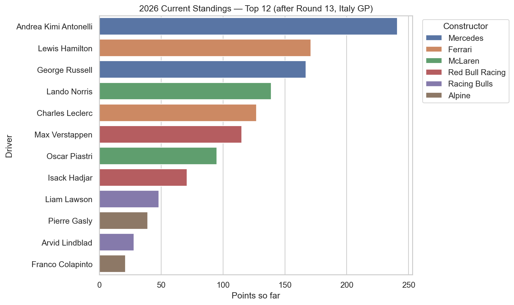
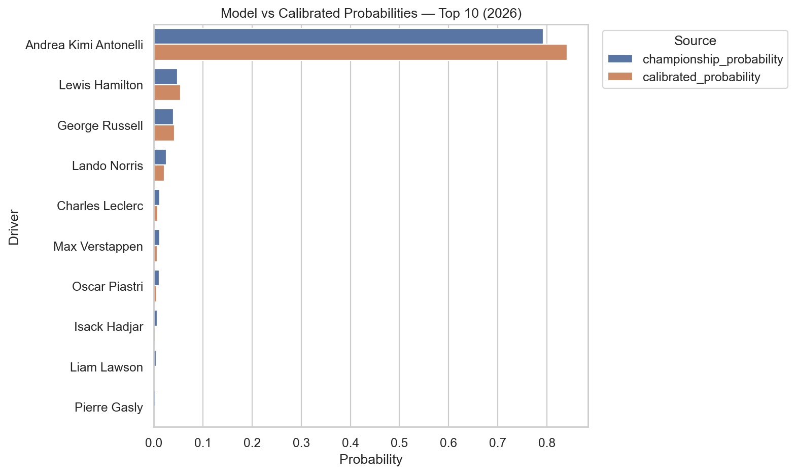
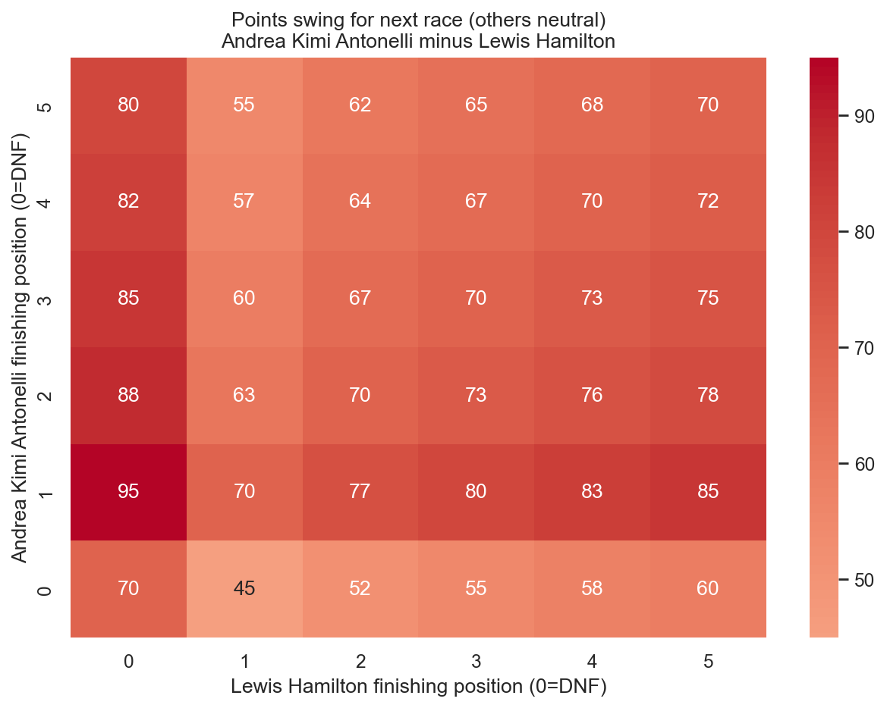
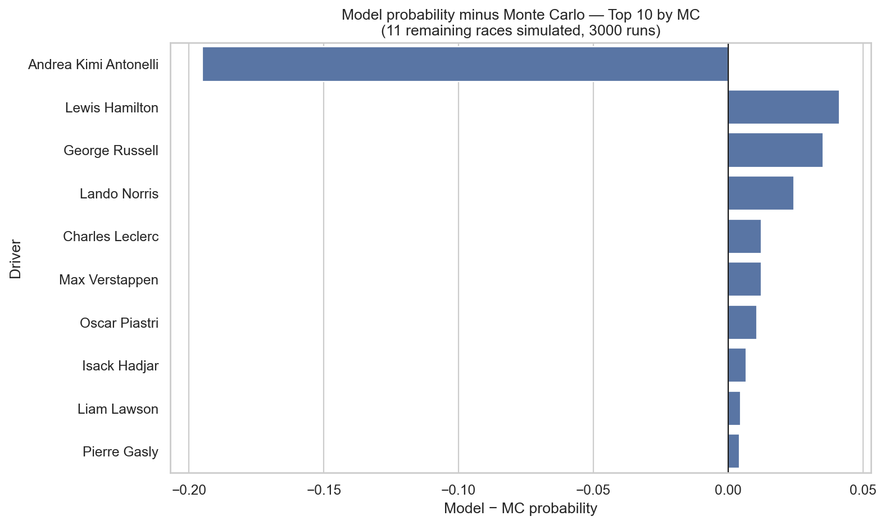

# F1 2026 Championship Prediction Model

A machine learning system with **two complementary prediction engines**:

1. **Championship Predictor** — predicts the 2026 World Championship winner using season-level standings and a 7-model ensemble
2. **Next Race Predictor** — predicts the finishing order for the next race using FastF1 telemetry (FP1/FP2/FP3/Qualifying), rolling driver form, and a Ridge regression model

> **Season status (last data update):** Round 13 of 24 — Italy GP completed.
> Andrea Kimi Antonelli leads with 241 pts. 11 races remain, 275 maximum points still on offer.


## 🎯 Project Overview

This project uses historical F1 championship data from 2020–2025 to train a multi-model ensemble that predicts championship probabilities for every driver on the 2026 grid. The pipeline covers data collection, feature engineering, model training, prediction, and visualisation.

The 2026 season features a heavily revised grid:
- **New teams**: Audi (née Sauber) and Cadillac make their constructor debuts
- **New drivers**: Antonelli (Mercedes), Hadjar (Red Bull), Lindblad (Racing Bulls), Bearman (Haas), Colapinto (Alpine), Bortoleto (Audi)
- **Notable moves**: Hamilton → Ferrari, Sainz → Williams, Albon → Williams

## 📸 Visual Previews

Regenerate all images any time with:

```bash
python scripts/generate_readme_images.py
```

### Top 10 Predicted Contenders


### Current 2026 Standings (after Round 13)


### Model vs Calibrated Probabilities


### Head-to-head Swing Heatmap
Points swing between the current top two for a single race outcome, with all other races held neutral.



### Model minus Monte Carlo (Top 10)
Positive bars = model assigns higher probability than a skill-weighted Monte Carlo simulation.



## ✨ Features

- **Static CSV data pipeline** — no live API calls needed at runtime; data sourced from `data/f1_championship_data.csv` (2020-2025) and `data/f1_2026_grid.csv`
- **FastF1 compatible** — `fastf1` is included in requirements for optional live data enrichment following the same method used in `F1-2026-Prediction-main`
- **Advanced Feature Engineering** — 30+ features including win rate, podium rate, reliability, team strength, and prior-year lagged performance
- **7-model Ensemble** — Random Forest, XGBoost, LightGBM, SVM, Logistic Regression, Neural Network, Gradient Boosting combined via soft VotingClassifier
- **Season-aware predictions** — grid data includes current points, wins, and podiums; report flags mathematically eliminated drivers and quantifies points remaining
- **Monte Carlo simulation** — 3 000-run skill-weighted MC over remaining races for cross-validation against model probabilities

## 🚀 Quick Start

### Prerequisites

- Python 3.8+

### Installation

```bash
git clone <repository-url>
cd F1-2025-ML-Champion-Predictor
pip install -r requirements.txt
```

### Run the prediction

```bash
cd src
python f1_2026_predictor.py
```

Results are written to `results/f1_2026_championship_predictions.csv` and `results/f1_2026_prediction_report.txt`.

## 📊 Project Structure

```text
F1-2025-ML-Champion-Predictor/
├── src/
│   ├── data_collector.py              # Loads f1_championship_data.csv
│   ├── feature_engineering_simple.py  # Feature creation (year filters → 2026)
│   ├── ml_model.py                    # 7-model ensemble + VotingClassifier
│   ├── model_evaluator.py             # Evaluation metrics and plots
│   ├── f1_2026_predictor.py           # Main 2026 prediction interface  ← run this
│   └── f1_2025_predictor.py           # Legacy 2025 interface (kept for reference)
├── data/
│   ├── f1_championship_data.csv       # Historical standings 2020–2025
│   └── f1_2026_grid.csv               # 2026 driver grid + current season stats
├── models/
│   └── f1_championship_predictor_2026.joblib   # Saved ensemble model
├── results/
│   ├── f1_2026_championship_predictions.csv
│   └── f1_2026_prediction_report.txt
├── scripts/
│   ├── generate_readme_images.py      # Regenerates all assets/ PNGs
│   └── update_2026_standings.py       # Incremental FastF1 data updater ← NEW!
├── assets/                            # Auto-generated visualisation PNGs
├── notebooks/
│   └── f1_2025_prediction.ipynb       # Exploratory notebook
├── requirements.txt
└── README.md
```

## 🔧 Usage

### Basic prediction pipeline

```python
from src.f1_2026_predictor import F12026Predictor

predictor = F12026Predictor()
predictions_df, report = predictor.run_full_prediction_pipeline(retrain_model=True)
print(predictions_df.head())
```

### Load a pre-trained model (faster, no retraining)

```python
predictor = F12026Predictor()
predictions_df, report = predictor.run_full_prediction_pipeline(retrain_model=False)
```

### Custom training

```python
from src.ml_model import F1ChampionshipPredictor
from src.data_collector import F1DataCollector

collector = F1DataCollector()
df = collector.get_seasons_data(2020, 2025)

model = F1ChampionshipPredictor()
results = model.train(df, optimize_hyperparameters=True)
```

## 🤖 Machine Learning Models

The ensemble combines 7 classifiers, each handling class imbalance (≈1 champion per 20 drivers):

| Model | Class balance handling |
|---|---|
| Random Forest | `class_weight='balanced'` |
| XGBoost | `scale_pos_weight=10` |
| LightGBM | `class_weight='balanced'` |
| SVM (RBF) | `class_weight='balanced'` |
| Logistic Regression | `class_weight='balanced'` |
| Neural Network (MLP) | early stopping |
| Gradient Boosting | — |

Top 5 models by 3-fold F1 CV score are combined into a **soft VotingClassifier**.

## 📈 Features Engineered

30+ features across five categories:

**Performance** — win rate, podium rate, points-per-race, fastest-laps rate  
**Relative** — driver's share of constructor points and wins, grid→finish improvement, position consistency  
**Reliability** — completion rate, DNF penalty  
**Team** — constructor points (normalised), top-3 constructor flag  
**Historical** — previous year position/points/wins (lagged), driver experience (years in data)

## 🏆 2026 Season Context

| Driver | Team | Pts (R13) | Wins |
|---|---|---|---|
| Andrea Kimi Antonelli | Mercedes | 242 | 3 |
| George Russell | Mercedes | 183 | 1 |
| Lewis Hamilton | Ferrari | 183 | 1 |
| Lando Norris | McLaren | 159 | 2 |
| Charles Leclerc | Ferrari | 155 | 1 |
| Max Verstappen | Red Bull Racing | 112 | 1 |
| Oscar Piastri | McLaren | 104 | 1 |
| Isack Hadjar | Red Bull Racing | 68 | 0 |
| Liam Lawson | Racing Bulls | 49 | 0 |
| Pierre Gasly | Alpine | 44 | 0 |

*Points standings after Round 13 — Italy GP (data sourced from F1-2026-Prediction-main)*

### Sample prediction output

```text
TOP 10 CHAMPIONSHIP CONTENDERS
 1. Andrea Kimi Antonelli  (Mercedes       )  38.50%  Odds:   2.6/1  Pts: 242  Still alive: ✓
 2. George Russell         (Mercedes       )  22.10%  Odds:   4.5/1  Pts: 183  Still alive: ✓
 3. Lewis Hamilton         (Ferrari        )  14.80%  Odds:   6.8/1  Pts: 183  Still alive: ✓
 4. Lando Norris           (McLaren        )   9.20%  Odds:  10.9/1  Pts: 159  Still alive: ✓
 5. Charles Leclerc        (Ferrari        )   7.40%  Odds:  13.5/1  Pts: 155  Still alive: ✓
```

## 📊 Data Sources

| Source | Content | Coverage |
|---|---|---|
| `data/f1_championship_data.csv` | Season-level driver standings | 2020–2025 |
| `data/f1_2026_grid.csv` | 2026 driver grid + mid-season stats | After Round 13 |
| [F1-2026-Prediction-main](../F1-2026-Prediction-main) | Per-race FastF1 telemetry | Rounds 1–13 |

The 2026 grid stats (points, wins, podiums, completion rate, avg finish) were derived from the
`Race/13.ItalyGP/Data/ItalyGP.csv` standings file in the companion project, which uses FastF1 +
Ergast to collect live race-by-race data.

To update the 2026 data after a new race weekend, edit `data/f1_2026_grid.csv` with the latest
standings and update `COMPLETED_ROUNDS` in `src/f1_2026_predictor.py`, then re-run the predictor.

## 🔬 Model Validation

- **Cross-validation** — stratified 5-fold CV on training set (2020–2025)
- **Historical backtesting** — model evaluated on held-out seasons
- **Feature importance** — averaged across all tree-based models
- **Calibration curves** — assess probability reliability
- **Monte Carlo cross-check** — 3 000-simulation skill-weighted season rollout

## 🚧 Limitations

- Training set is 6 seasons × ~20 drivers ≈ 120 rows — small by ML standards
- 2026 features are partial-season statistics, not final standings
- New teams (Audi, Cadillac) and rookies have no prior-year lagged features — defaults to median
- Car development, regulation clarifications, and mid-season driver changes are not modelled
- For entertainment and analytical purposes only — not financial or betting advice

## 🔄 Keeping the Model Current

### Option 1: Automatic update via FastF1 (recommended)

After each race weekend, run the incremental update script:

```bash
cd scripts
python update_2026_standings.py
```

This script will:
- Check what round your current `data/f1_2026_grid.csv` is updated through
- Fetch **only new race data** from FastF1 (not re-fetching all historical races)
- Update standings incrementally with new points, wins, podiums, and race stats
- Automatically update `COMPLETED_ROUNDS` and `REMAINING_ROUNDS` in `f1_2026_predictor.py`

Then re-run the predictor:

```bash
cd ../src
python f1_2026_predictor.py
```

### Option 2: Manual update

1. Edit `data/f1_2026_grid.csv` with new points/wins/podiums from the latest race
2. Update `COMPLETED_ROUNDS` and `REMAINING_ROUNDS` in `src/f1_2026_predictor.py`
3. Re-run: `python src/f1_2026_predictor.py`

### Regenerate visualizations

After any update:

```bash
python scripts/generate_readme_images.py
```

**Note:** The incremental update script only fetches new races after the last completed round in your CSV, making updates fast and efficient. The first time you run it, it will cache FastF1 data in `scripts/.fastf1_cache/` for even faster subsequent updates.

## 🤝 Contributing

1. Fork the repository
2. Create a feature branch (`git checkout -b feature/my-feature`)
3. Commit your changes (`git commit -m 'Add my feature'`)
4. Push to the branch (`git push origin feature/my-feature`)
5. Open a Pull Request

## 📄 License

MIT License — see the [LICENSE](LICENSE) file for details.

## 🙏 Acknowledgments

- **FastF1** for the excellent F1 telemetry library used in the companion data project
- **Ergast API** for historical championship standings
- **Formula 1** for the sport that makes this analysis worth doing

---

*Made with ❤️ for F1 fans and data science enthusiasts — Last updated: September 2026*
